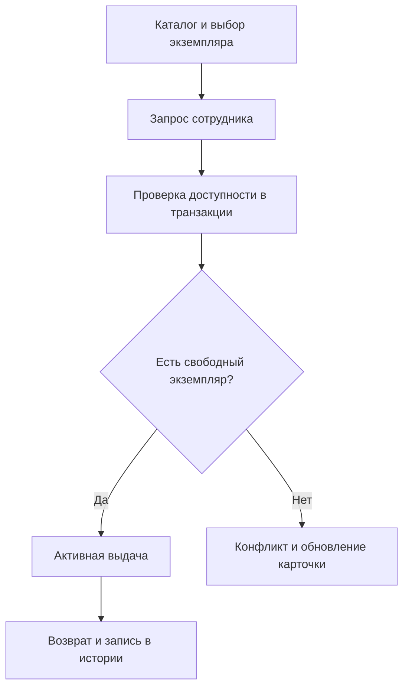

# 204 · Библиотека вещей для офиса

Репозиторий `office-lending-library` · приложение с сервером

**Продукт и интерфейс.** Сотрудник ищет книгу, переходник или игру, видит доступность и оформляет выдачу. Куратор редактирует каталог и видит просрочки. Нужны список с фильтрами, карточка экземпляра, мои выдачи и журнал операций.

**Архитектура и данные.** React, FastAPI, SQLite. Таблицы пользователей, предметов, физических экземпляров и выдач. API выдаёт экземпляр со сроком, закрывает выдачу при возврате и рассчитывает доступность по открытым операциям. Уникальное ограничение на активную выдачу экземпляра защищает от параллельной выдачи. Поиск по названию и категории, без ML.

**Блок-схема основного сценария**

**Функциональные правила.** Хранить каталог и физические экземпляры отдельно. Наличие определять по экземплярам без открытой выдачи, просрочку вычислять по сроку активной выдачи. Возврат закрывает существующую запись с фактическим временем.

**Контракты реализации.** API `GET /items`, `POST /loans`, `POST /loans/{id}/return` и `GET /loans?status=overdue`. Сервер получает автора из сессии, а уникальный индекс допускает одну активную выдачу на экземпляр.

**Проверки граничных случаев.** Два параллельных запроса дают один успех и один конфликт. Повтор возврата возвращает текущее состояние без повторной записи в журнал.

**Разработка и приёмка.** Поднять каталог и демопользователей, реализовать выдачу и возврат, добавить фильтры и журнал. Два пользователя одновременно запрашивают один экземпляр: выдача подтверждается одному. После возврата второй может забрать вещь, история обеих операций сохраняется.
